<a href="https://logiqd.me">
  <picture>
    <source media="(prefers-color-scheme: dark)" srcset="./assets/banner-dark.svg">
    
  </picture>
</a>

 

## 🐋 Quiénes somos

Somos un **equipo pequeño de Barcelona** que ayuda a los negocios a dar el salto a internet: barberías, restaurantes, clínicas, tiendas, academias y profesionales que quieren que les encuentren y les escriban.

Nada de agencias enormes ni de hablar cada vez con alguien distinto: **hablas directamente con quien construye tu proyecto**.

## 🛠️ Qué hacemos

<table>
  <tr>
    <td width="33%" valign="top">
      <h3>🌐 Páginas web</h3>
      Webs a medida que explican bien tu negocio, se ven perfectas en el móvil y facilitan que te contacten.
    </td>
    <td width="33%" valign="top">
      <h3>🛒 Tiendas online</h3>
      Catálogo, fotos, carrito y pago con tarjeta para vender por internet desde el primer día.
    </td>
    <td width="33%" valign="top">
      <h3>🔎 Salir en Google</h3>
      SEO local y webs rápidas para aparecer cuando alguien de tu zona busca lo que ofreces.
    </td>
  </tr>
  <tr>
    <td width="33%" valign="top">
      <h3>🤖 Automatización e IA</h3>
      Recepción con IA, respuestas automáticas, captación de leads y avisos que se envían solos.
    </td>
    <td width="33%" valign="top">
      <h3>🧩 Herramientas a medida</h3>
      Zonas privadas, pedidos, reservas o inventario, con paneles y gráficos sencillos.
    </td>
    <td width="33%" valign="top">
      <h3>🔧 Mantenimiento</h3>
      Cambios, copias de seguridad, vigilancia de la web y ayuda cuando la necesites.
    </td>
  </tr>
</table>

## 🍽️ Restaurant OS

> **Digital cuando aporta comodidad. Humano siempre disponible.**

Nuestro sistema para restaurantes: tus clientes **piden desde la mesa con un QR**, cocina y barra ven cada pedido en su pantalla, y cobrar o dividir la cuenta lleva segundos. Incluye reservas y lista de espera, sin descargar ninguna app — y quien prefiera la carta de papel y pedir al camarero puede seguir haciéndolo, con su pedido en la misma cuenta.

## 🤝 Cómo trabajamos

| | Paso | Qué significa para ti |
|:-:|---|---|
| **1** | **Cuéntanos tu proyecto** | Por WhatsApp, por correo o con el formulario. Sin compromiso. |
| **2** | **Precio cerrado en 24&nbsp;h** | Sabes lo que cuesta y lo que incluye antes de empezar. Sin extras a mitad de camino. |
| **3** | **Diseñamos y creamos** | Te enseñamos cómo quedará antes de terminarlo. |
| **4** | **Lo revisamos contigo** | Cambiamos lo que haga falta hasta que te guste. |
| **5** | **Lanzamiento** | Publicado con tu dominio, listo para que te encuentren. Tu web, en 2–3 semanas. |

**Sin permanencia** · **Pensado para móvil** · **Nos encargamos de lo técnico**: hosting, dominio y publicación.

## ⚙️ Con qué trabajamos

 

## 👋 El equipo

| [ **Gerard**](https://github.com/Elgeryy1) | [ **Dani**](https://github.com/dc8306) |
|:-:|:-:|
| Cofundador | Cofundador |

---

### ¿Tienes un negocio y quieres más clientes?

**Cuéntanos qué necesitas y te decimos cómo hacerlo.**

[**logiqd.me**](https://logiqd.me) · [hola@logiqd.me](mailto:hola@logiqd.me) · [WhatsApp](https://wa.me/34613939162)

Hecho con 🧡 en Barcelona

